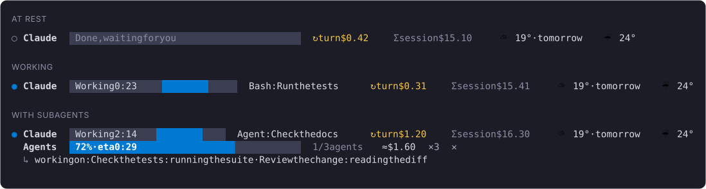
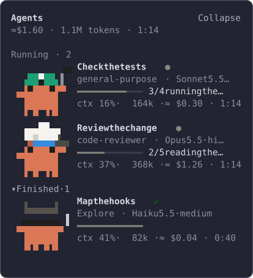

# savvy-progress

A Claude Code mod for the terminal. It puts a bar above the prompt that always says what the session is doing and what it costs, shows the weather if you want it, and opens a live panel of subagents with a walking crab per agent.



> Fork of [johnnyvizz/claude-kit](https://github.com/johnnyvizz/claude-kit) `savvy-progress` 1.2.0 (MIT, see `LICENSE`). The desktop drawing is upstream's, untouched. Everything below is about the terminal.

## What it shows

- **The first row is the main session's own, and always there.** Under the name `Claude` a bar in which a block slides with `Working 0:22` while a turn runs, and beside it what is in hand: every tool call of the main loop is named (`Bash: <what the call is about>`, `Read: <file>`), with `thinking` between them. The bar reads `Waiting for 2 agents` while only subagents run and `Done, waiting for you` at rest. Nothing has to report for it: the mod watches the turn and its tool calls.
- **Two costs, each labelled.** `↻ turn` is what was spent since your last prompt; a subagent's notification continues the turn, it does not start one. `Σ session` is the engine's own total, the figure `/cost` shows, asked again after every answered request. Both are shown to the cent.
- **The weather, if you set a place.** Now and tomorrow, as `⛅ 19° · tomorrow ☔ 24°`. See [The weather](#the-weather).
- **The agents bar sits under that row** while subagents run. Any subagent starts it, with no flow reporting: it counts the agents, and 20 seconds after the last one ends it leaves. With `/savvy-flow` reporting it shows percent and time left; with nothing to measure, a block slides and no percent is made up.
- **The panel opens and closes by itself.** Any subagent opens it, and 5 seconds after the last one ends it closes again, also when you opened it by hand. A panel you open at rest (`/agents-info`) stays until you close it. Each agent is a crab drawn in cells that walks while it works, in a costume of its own per agent type.
- **Marks.** `✗ n` for failed runs and `quiet 4m` for a running worker with no sign of life for three minutes or more.
- **Room.** When the band is narrow (a docked panel takes 44 columns) tomorrow's weather gives way first, then the weather, before the note of what is in hand does. Below 60 columns the costs keep their marks and drop their words.



Both pictures are drawn from what the mod itself returns, cell for cell; the font and the exact colors are your terminal's.

## Install

At the prompt of a terminal session:

```
/plugin install savvy-progress --marketplace Solutionmax/savvy-progress
```

Answer `y` to add the marketplace and pick a scope. If the original `savvy-progress@claude-kit` is installed, disable it first: both register the same tools.

A panel the mod opens by itself is only drawn on a terminal of 144 columns or more (110 once you have opened it yourself). On a narrower one a notice says so once; `/agents-info` opens it at any width.

## Settings

| Setting | Default | What it does |
| --- | --- | --- |
| `language` | `auto` | `auto`, `en`, `nl` or `ru`. `auto` follows Claude Code's `language` setting, then the system locale, and falls back to English. |
| `barColor` | `#0079d2` | The color of the bar and its sliding block. |
| `paneBackground` | `#232431` | A color painted over the panel; empty leaves the engine's own. |
| `weatherPlace` | empty | Latitude and longitude for the weather, as `lat,lon`; empty leaves the weather off. |

Change them with `/plugin configure savvy-progress@solutionmax`, or in `~/.claude/settings.json`, keyed by the mod's name and the marketplace it came from:

```json
{
  "pluginConfigs": {
    "savvy-progress@solutionmax": {
      "options": { "barColor": "#e5484d", "weatherPlace": "52.37,4.90", "language": "en" }
    }
  }
}
```

After editing the file, type `/reload-plugins`. The settings can also be given as the mod is installed from a shell: `claude plugin install savvy-progress@solutionmax --config barColor=#e5484d --config weatherPlace=52.37,4.90`.

### The color of the bar

Set `barColor` to a hex color, with three or six digits: `#0079d2` (the default blue), `#e5484d` (red), `#2e9e6b` (green), `#f80` (orange). The sliding block, the fill of the agents bar and the mark before `Claude` all take it. A value that is no hex color leaves the default, so a typo cannot blank the row.

The other colors are constants at the top of `hooks/register.tsx`, for when you run the mod from your own folder: `TRACK` (the empty part of the bar), `TURN` (the amber of the turn's cost) and `DONE` (the green of a finished agents bar).

### The weather

Set `weatherPlace` to the latitude and longitude of your place, as two numbers with a comma between them: `52.37,4.90` is Amsterdam, `40.71,-74.01` New York. Most map apps show the two numbers when you right-click a spot. Leave it empty to turn the weather off.

What you get is the weather now (icon and temperature) and tomorrow's (icon and maximum), in degrees Celsius:

| Icon | Sky |
| --- | --- |
| 🌞 / 🌙 | clear, by day and by night |
| ⛅ | some cloud, or overcast |
| 🌁 | fog |
| ☔ | drizzle, rain or showers |
| ⛄ | snow |
| ⚡ | thunderstorm |

The forecast comes from [Open-Meteo](https://open-meteo.com), with no key and no account. As the mod loads and every half hour after, one request goes to `api.open-meteo.com` carrying those two numbers and nothing else. With the place empty no request is made. A reading that could not be refreshed stays for two hours and is then dropped, so the bar never shows old weather as now.

## Tools it adds

- `mcp__savvy-progress__progress`: an orchestrator reports its plan, phase and accepted tasks.
- `mcp__savvy-progress__step`: a worker reports its own steps (`done`, `total`, `note`). A worker that does not report shows its context fill in grey instead.

The `≈` figures in the agents bar and the panel are estimates from token counts and a built-in price table (`PRICES` in `hooks/register.tsx`), not a bill. The turn's and the session's costs in the first row are the engine's own.

## Working on it

Clone the repository and start a session with the mod read from that folder:

```
claude --plugin-dir /path/to/savvy-progress
```

After a change run `claude plugin validate .` and `claude plugin test .` in the folder. The terminal code is in `hooks/terminal-art.ts`, `hooks/main-session.ts`, `hooks/weather.ts` and the two terminal branches of `hooks/register.tsx`.

Known limits: an agent started by a workflow has no end the mod can see, so it stays listed as running; the first row is drawn in a terminal only, the desktop keeps upstream's bar.

## License

MIT, as upstream. See `LICENSE`.
